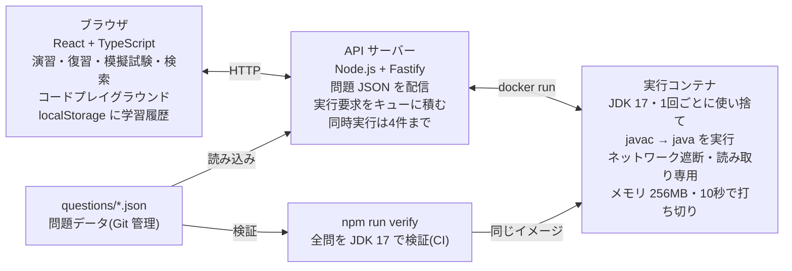
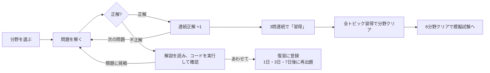

# Java Silver SE 17 学習アプリ 設計

2026-11-11 に claude.ai の Docs で作った設計提案「Java Silver SE 17 学習アプリ 設計提案と問題セット(演算子と制御構造)」を、リポジトリに移したものです。以後はこのファイルを正とします。

- 類題(即時類題・復習バリエーション)の決まりは [similar-question-policy.md](similar-question-policy.md) に分けました。
- 実行サーバーの構築とコネクタ登録は [runner-deployment.md](runner-deployment.md) にあります。
- 4章と5章の数値は、移行時点のデータ(25組・75問)に合わせて更新しました。

## 1. アーキテクチャと技術スタック

この章は当初の設計です。実際に作った構成との違いは、この章の末尾にある「公開版」を見てください。

コード実行は **A. セルフホスト型(Docker + JDK 17)** を採用します。フロントは React + TypeScript、バックエンドは Node.js + TypeScript で、型定義をフロントと共有します。問題データは Git 管理の JSON、学習履歴はブラウザの localStorage に保存します。

| 構成要素 | 採用技術 | 役割 |
| --- | --- | --- |
| フロントエンド | React 18 + TypeScript + Vite、React Router、CodeMirror 6 | 演習・復習・模擬試験・検索の画面、コードプレイグラウンド |
| バックエンド | Node.js 20 + TypeScript + Fastify | 問題配信API、コード実行API、同時実行数の制御 |
| コード実行 | Docker + eclipse-temurin:17-jdk ベースの専用イメージ | 1回ごとに使い捨てコンテナで javac / java を実行 |
| 問題データ | questions/\*.json(Git管理)+ JSON Schema | 分野・トピック・類題ペア・検証定義を保持 |
| 学習履歴 | localStorage(JSONエクスポート/インポート付き) | 解答履歴・トピック習熟度・復習スケジュール |
| 品質検証 | npm run verify(CIでも実行) | 全問題のコードをJDK 17で実行し、正解・解説と食い違えば失敗させる |



プレイグラウンドの実行と問題の品質検証は、同じ JDK 17 イメージを使います。学習者が解説から実行した結果は、問題の正解と必ず一致します。

### コード実行方式の選択理由

決め手は「JDK 17 に固定できること」と「本試験の問題形式をそのまま再現できること」です。外部APIは手軽ですが、提供される JDK のバージョンを自分で選べません。例えば Judge0 CE v1.13.1 の API ドキュメントで有効な Java は OpenJDK 13.0.1 です([Judge0 CE API Docs](https://ce.judge0.com/))。

| 観点 | A. セルフホスト(採用) | B. 外部API(Piston / Judge0) |
| --- | --- | --- |
| JDK バージョン | イメージのタグで 17 に固定 | 提供側次第 |
| 複数ファイル・パッケージ | ディレクトリ構成ごと渡せる(package ex4; など) | 単一ファイル前提のことが多い |
| 実行コマンドの再現 | java Main java one two、java Test.java(ソースファイルモード)も再現可 | 引数やコマンドの指定に制約 |
| エラーメッセージ | javac の日本語メッセージ(-J-Duser.language=ja)をそのまま表示 | 英語固定のことが多い |
| 外部依存 | なし(レート制限・障害・規約変更の影響を受けない) | API の可用性とレート制限に依存 |
| 運用負荷 | Docker が必要。サンドボックスの安全設定を自前で担保 | ほぼゼロ |
| 速度 | JVM を2回起動(javac と java)するため1回数秒 | ネットワーク往復が加わる |

受け入れるトレードオフは「Docker が必要」「安全設定の責任を持つ」の2点です。docker compose up 一発で起動できる構成にして、前者の負担を抑えます。

### サンドボックスの安全性要件

| 要件 | 実装 |
| --- | --- |
| 実行時間タイムアウト | コンパイル10秒・実行10秒。超過したら docker kill し「タイムアウト(無限ループの可能性)」と表示 |
| ネットワーク無効化 | --network none |
| ファイルシステム隔離 | --read-only + 作業ディレクトリだけ tmpfs。ホストのディレクトリはマウントせず、ソースは標準入力で渡す |
| リソース上限 | --memory 256m、--cpus 1、--pids-limit 64。標準出力は64KBで打ち切り |
| 権限 | 非 root ユーザー、--cap-drop ALL、--security-opt no-new-privileges |
| 同時実行数の制限 | API サーバー内のセマフォで同時4件まで。待ち行列16件を超えたら HTTP 429 |

### コードプレイグラウンド

- エディタは CodeMirror 6(行番号・Java のシンタックスハイライト)。ボタンは「実行」「リセット」「フォーマット」
- フォーマットはブラウザ内の prettier + prettier-plugin-java。構文エラーで整形できないときはその旨を表示
- 結果パネルは「標準出力」「コンパイルエラー(行番号クリックで該当行へ)」「実行時例外」を切り替え表示
- コマンドライン引数の入力欄を置き、実際に実行したコマンド(例: java Main java one two)を表示

### 学習履歴の保存先

localStorage を選んだのは、ログイン不要ですぐ使え、サーバーに個人データを持たずに済むためです。代わりに端末間の同期はできないので、JSON のエクスポート/インポートで補います。将来同期が必要になれば SQLite + 簡易ログインを足せる設計にします。

### 公開版(2026-11-11 に実装)

claude.ai 上で開くだけで使える公開 Web アプリとして実装しました(React + TypeScript、サーバーなし。ソースは `app/`)。上の構成とは次の3点が違います。

- コード実行: 書き換えていないコードは JDK 17 で検証した実際の出力(javac のエラー、標準出力、例外)を表示する。書き換えたコードはカスタムコネクタ「Java Silver Runner」経由で自前の実行サーバー(リモート MCP の `run_java`。OAuth か固定トークンによる認証が必須)に送り、使い捨てのサンドボックスで実行する。コネクタが未登録ならその旨を画面で案内する。サーバーは `runner/`、構築と登録は [runner-deployment.md](runner-deployment.md) を参照
- 学習履歴: claude.ai のアカウントごとの専用領域に保存し、端末をまたいで続きから学習できる。使えないときはブラウザの localStorage に保存する
- 品質検証: `npm run questions:verify` で手元の JDK 17 を使って全問を検証する(`tools/verify-questions.mjs`)。CI での実行はまだ設定していない

模擬試験の答えは復習リストにだけ反映し、トピックの習熟度は動かしません。模試の結果で「クリア」が消えると「全分野クリア → 模試」の流れが崩れるためです。

## 2. データ設計

問題は「分野 → トピック → 類題の組 → 問題(表 a / 即時類題 b / 復習バリエーション c)」の4階層で持ちます。分野ごとに25組(3問ずつ、計75問)、全6分野で450問になります(詳しくは [similar-question-policy.md](similar-question-policy.md))。各問題に「何を実行すれば正解を証明できるか」という検証定義を持たせ、品質チェックを自動化します。

| 項目 | 形式 | 例 |
| --- | --- | --- |
| 分野 ID | 6種類の固定値 | basics / types / operators / classes / inheritance / exceptions |
| トピック ID | 分野の接頭辞 + 名前 | oc-switch-expr |
| 類題の組 ID | 分野の接頭辞 + 通し番号 | oc-18 |
| 問題 ID | 組 ID + a(表)/ b(即時類題)/ c(復習バリエーション) | oc-18a, oc-18b, oc-18c |
| ファイル配置 | 分野ごとに1ファイル | questions/operators.json、topics.json |

### 問題データの型

```typescript
type Question = {
  id: string;               // "oc-18a"
  pairId: string;           // "oc-18"(同じ組の3問で共有)
  side: "a" | "b" | "c";    // a = 表、b = 即時類題、c = 復習バリエーション
  fieldId: FieldId;         // "operators"
  topicId: string;          // "oc-switch-expr"
  tags: string[];           // ["switch式", "yield", "網羅性"]
  difficulty: 1 | 2 | 3;    // 易・中・難
  format: "result" | "compile" | "knowledge";  // 実行結果を選ぶ / コンパイル可否を選ぶ / 知識
  prompt: string;           // 問題文
  files: { path: string; code: string }[];  // 問題コード(複数ファイル可)
  command?: string;         // "java Main java one two"
  selectCount: number;      // 「2つ選択」なら 2
  options: { label: string; text?: string; code?: string; claim?: Claim }[];  // 4〜9個
  answer: string[];         // ["B", "E"]
  explanation: {
    point: string;          // 要点(即解説で常に表示)
    detail: string;         // 詳しい解説(折りたたみ)
    options: Record<string, string>;  // 選択肢ごとの1行解説
    compileErrors?: { option?: string; file: string; line: number; message: string }[];  // javac の実メッセージ(検証時に自動記入)
  };
  variationNote?: string;   // 復習バリエーション(c)だけ: 表との違いを1行で
  refs: { title: string; url: string }[];   // JLS / Oracleチュートリアル
  verify:
    | { kind: "program" }   // files を実行し、正解の claim だけが一致することを確認
    | { kind: "per-option"; template: string; polarity: "error" | "ok" }  // 選択肢ごとにコンパイル
    | { kind: "none"; reason: string };   // 知識問題(コードなし)
};

// 選択肢が主張する「実行結果」。検証スクリプトが実際の結果と照合する
type Claim =
  | { stdout: string }
  | { stdout?: string; exception: string }            // 例外の完全修飾名
  | { compileError: { file?: string; lines?: number[] } }
  | { timeout: true };                                 // 無限ループ
```

保存形式では、コード(`files[].code`、`verify.template`)は1行1要素の文字列配列です。

検証の要は claim です。実行結果形式の問題は、全選択肢に「この選択肢が正しいなら実際に起きること」を持たせます。その上で「正解の claim だけが実際の結果と一致し、他はすべて不一致」を確認します。これで正解が複数ある問題や、正解がどれにも当たらない問題を機械的に弾けます。「コンパイルエラーになるものを選べ」型は、各選択肢を雛形に埋め込んで個別にコンパイルし、正解集合と一致するかを確認します。

### 学習状態のルール



中心は「間違える → 解説とコード実行 → 類題」のループです。各ルールの細部は下の表のとおりです。

| 機能 | ルール |
| --- | --- |
| トピック習熟度 | 未学習 = 解答0回。演習中 = 1回以上。習得 = そのトピックで3問連続正解(表と即時類題は問わない)。習得後に間違えると演習中に戻る |
| 分野クリア | 分野内の全トピックが習得。6分野クリアでトップに模擬試験への導線を出す |
| 類題の即出題 | 不正解 → 解説 → 「類題に挑戦」で同じ組の即時類題(b)を出題。その即時類題をすでに解いていれば、同じトピックの未出題の即時類題 |
| 復習(間隔反復) | 不正解の組を1日後に登録。期日には元の問題ではなく復習バリエーションを出す([類題ポリシー](similar-question-policy.md))。正解すると3日後 → 7日後と進み、7日後も正解で卒業。途中で間違えると1日後に戻る |
| 模擬試験 | 60問・90分。初期値は各分野10問(設定で変更可)。各組から表か復習バリエーションのどちらか1問だけを出す。39問(65%)以上で合格表示 |

学習履歴は1つの JSON(attempts / topics / reviews / mocks)として保存し、version フィールドで将来の形式変更に備えます。現在は version 2 で、v1 からの移行処理を `app/src/store.ts` に持っています。

## 3. 「演算子と制御構造」のトピックと配分

25組を10トピックに分け、表の難易度は易8・中12・難5(3:5:2 を 25 問に丸めた値)です。即時類題(b)は表と同じ難易度・同じ形式、復習バリエーション(c)は表と同じトピック・同じ難易度です。

| トピック | 組数 | 易・中・難 | 主な論点 |
| --- | --- | --- | --- |
| 算術演算子とインクリメント | 3 | 1・1・1 | 前置と後置、評価順序、整数除算と 0 除算 |
| 代入と複合代入 | 2 | 0・2・0 | 複合代入の暗黙のキャスト、x = x++ |
| 関係・論理演算子と短絡評価 | 3 | 0・2・1 | && と \|\| の短絡評価、両辺を評価する & \| ^、&& と \|\| の優先順位 |
| 三項演算子と優先順位 | 2 | 1・1・0 | 入れ子の三項演算子、\* / % と文字列連結 |
| if文 | 2 | 1・1・0 | 条件式の型(if (x = 10))、ぶら下がり else |
| switch文 | 4 | 1・2・1 | フォールスルー、使える型、case ラベルの制約、default の位置 |
| switch式とアロー構文 | 3 | 1・1・1 | アロー形式はフォールスルーしない、yield、網羅性 |
| while / do-while と到達可能性 | 2 | 1・1・0 | 前判定と後判定、到達不能コード |
| for文と拡張for文 | 2 | 2・0・0 | 複数変数の初期化と更新、拡張 for の変数はコピー |
| break・continue・ラベル | 2 | 0・1・1 | ラベル付き break / continue、ラベルを付けられる文 |

形式は「実行結果を選ぶ」19組(うち正解がコンパイルエラー・例外になるものを含む)と、「コンパイル可否を選ぶ」6組(すべて複数選択)です。選択肢は4〜7個で、単一選択の57問の正解位置は A12・B11・C17・D12・E5 に分散させています。競合しやすい Java 17 のプレビュー機能(switch の型パターン)は出題せず、「long は switch に使えない」問題の解説で範囲外だと明記しています。

## 4. 問題セット(25組・75問)

全問の本文・コード・選択肢・解説は、`npm run review` で作るレビュー用ページ(`reports/review/operators-review.html`)で見られます。表・即時類題・復習バリエーションを横に並べ、「自分で解く」に切り替えると正解を隠して解けます。claude.ai 上の [演算子と制御構造 問題レビュー](https://claude.ai/artifact/EReEC2UX2GvAZ6Bzfz9MbM) も同じ内容です。下の表はその索引で、`questions/operators.json` から作りました。

| 組 | 難易度 | トピック | 表(a)のタグ | 復習バリエーション(c)の角度 | 正解 a / b / c |
| --- | --- | --- | --- | --- | --- |
| oc-01 | 易 | 算術演算子とインクリメント | 後置インクリメント・前置インクリメント | 表は後置 x++、こちらは前置 ++count の値を問う | B / D / C |
| oc-02 | 中 | 算術演算子とインクリメント | インクリメント・デクリメント・評価順序・優先順位 | 演算子を変え、デクリメントを中心にした式で評価順序を問う | C / A / D |
| oc-03 | 難 | 算術演算子とインクリメント | 整数除算・剰余・ArithmeticException・Infinity | 0 除算を % 0 に変え、右オペランドが負の剰余も問う | B / D / D |
| oc-04 | 中 | 代入と複合代入 | 複合代入・暗黙のキャスト・型変換 | 小数を含む複合代入と、double リテラルを float に代入できるかを問う | B,E / A,F / A,D |
| oc-05 | 中 | 代入と複合代入 | 複合代入・後置インクリメント・評価順序 | 乗算の複合代入と後置デクリメントで、同じ「左辺の値を先に保存する」規則を問う | D / B / A |
| oc-06 | 中 | 関係・論理演算子と短絡評価 | 短絡評価・&&・\|\| | 短絡しない & と \| で、右辺が必ず評価されることを問う | A / C / C |
| oc-07 | 中 | 関係・論理演算子と短絡評価 | 関係演算子・論理否定・優先順位 | && のオペランドの型と、比較を2つ続けたときの型を問う | B,D / A,E / B,E |
| oc-08 | 難 | 関係・論理演算子と短絡評価 | 短絡評価・優先順位・&&・\|\| | && の左辺が false になる側の短絡と、\|\| の右辺が評価される流れを問う | D / B / E |
| oc-09 | 易 | 三項演算子と優先順位 | 三項演算子・入れ子 | 表は入れ子の三項演算子の評価、こちらは三項演算子が「式」であり単独の文にできないことを問う | B / C / C |
| oc-10 | 中 | 三項演算子と優先順位 | 優先順位・文字列連結・剰余 | 文字列が先頭にある連結と、/ と * の左結合を問う | E / C / A |
| oc-11 | 易 | if文 | if文・代入式・条件式の型 | boolean への代入式を条件にしたとき、エラーにならず実行される側を問う | E / C / B |
| oc-12 | 中 | if文 | if文・ぶら下がりelse・中かっこの省略 | 表はぶら下がり else の結びつき、こちらは中かっこを省略した if の対象が直後の1文だけであることを問う | C / A / C |
| oc-13 | 易 | switch文 | switch文・フォールスルー・break | String の switch で default までフォールスルーすることを問う | D / B / C |
| oc-14 | 中 | switch文 | switch文・switchに使える型・ラッパークラス | ラッパークラス(Long、Boolean)と float、int の switch に char の case を書けるかを問う | A,D,F / B,E,G / B,D,G |
| oc-15 | 難 | switch文 | switch文・caseラベル・定数式・型の範囲 | 定数でない case に加え、文字定数と数値の case の重複を問う | C / E / E |
| oc-16 | 中 | switch文 | switch文・default・フォールスルー | 途中にある default は、一致する case があると実行されないことを問う | B / D / D |
| oc-17 | 易 | switch式とアロー構文 | アロー構文・switch文・フォールスルー | カンマ区切りの複数ラベルを問う | D / A / B |
| oc-18 | 中 | switch式とアロー構文 | switch式・yield・網羅性 | コロン形式とアロー形式の混在・break・結果の型という別の制約を問う | B,C / B,F / A,D |
| oc-19 | 難 | switch式とアロー構文 | switch式・yield・コロン形式・フォールスルー | String の switch 式で、途中の case から始まるフォールスルーを問う | A / C / D |
| oc-20 | 易 | while / do-while と到達可能性 | do-while文・while文 | while 文は1回も実行されないことがある側を問う | B / A / C |
| oc-21 | 中 | while / do-while と到達可能性 | 到達不能コード・while文・for文・定数式 | break のない無限ループの後ろの文が到達不能になる側を問う | A,D / C,E / B,D |
| oc-22 | 易 | for文と拡張for文 | for文・複数の変数・更新部 | 更新部が乗算で、条件式にも計算を含む for 文を問う | A / C / D |
| oc-23 | 易 | for文と拡張for文 | 拡張for文・var・変数のスコープ | 参照型(String)の要素でも、拡張 for の変数への代入は配列を変えないことを問う | B / A / A |
| oc-24 | 中 | break・continue・ラベル | ラベル・continue・break・入れ子のループ | continue と break の条件と位置を変え、出力の直後に break する流れを問う | A / C / C |
| oc-25 | 難 | break・continue・ラベル | ラベル・break・continue・ラベル付きブロック | ラベルなしの break と、ブロックのラベルへの continue を問う | B,D / A,E / A,E |

## 5. JDK 17 での検証結果

75問すべてで、正解の選択肢だけが実際の結果と一致しました(OpenJDK 17.0.21、2026-11-11 実施。結果は `reports/verification-report.json`)。実行結果形式57問はコンパイルと実行を各1回、コンパイル可否形式18問は選択肢ごとに計102回コンパイルしています。類題の構造チェックも25組で問題 0件です。

| 確認したこと | 方法 | 結果 |
| --- | --- | --- |
| 正解がちょうど1つ(または指定数)ある | 全選択肢の claim を実行結果と照合し、一致した集合と正解を比べる | 75 / 75 |
| コンパイルエラーの行番号 | javac の出力から行番号を取り出し、選択肢の行番号と照合 | oc-09c、oc-11a、oc-11b、oc-15a、oc-15b、oc-15c で一致 |
| 例外の種類とそれまでの出力 | 標準エラーの例外クラス名と標準出力を照合 | oc-03a、oc-03b、oc-03c で一致 |
| 即時類題と復習バリエーションの作り分け | コードを字句に分けて比べる構造チェック([類題ポリシー](similar-question-policy.md)) | 25組で問題 0件 |
| 検証そのものが誤りを検出できる | 正解をわざと書き換えたデータで実行 | oc-02a、oc-14a とも NG を検出 |
| 解説のエラーメッセージ | javac の日本語メッセージを explanation.compileErrors に自動で書き戻し | 例: oc-11a 7行目「不適合な型: intをbooleanに変換できません」 |

検証の過程で直した点は次のとおりです(ID は現在のもの)。

1. oc-15a: 当初 `int two` を byte の switch の case に使ったところ、エラー理由が「定数式が必要です」ではなく「intからbyteへの変換」になりました。`byte two` にして、解説どおりの理由でエラーになるようにしました。
2. oc-15c(移行前の oc-15b): 同じ理由で、switch の型を short から int に変えました。
3. oc-07 と oc-18: 選択肢が前提にする変数宣言(int a = 4, b = 6; など)を問題文に明記しました。
4. 単一選択の正解位置が A に偏っていた(表19問中12問)ため、選択肢の並びを入れ替えて再検証しました。
5. oc-09b: 構造チェックを通すため、比較演算子を表と同じ >= にそろえました。

Java 17 では long 等を switch に書くと、型パターン(プレビュー機能)を案内する英語混じりのメッセージが出ます。学習者が混乱しないよう、oc-14 の解説で「プレビュー機能で Silver の範囲外」と補足しています。

## 6. フィードバック項目(2026-11-11 時点の記録)

分野3を作った時点で、次の5点についてフィードバックをお願いしました。2 は類題ポリシーとして決着済みです。

1. 難易度の体感: 易・中・難の付け方が本試験の感覚と合っているか(特に難の oc-03・oc-08・oc-15・oc-19・oc-25)
2. 類題の作り方: 数値・変数名を変えるだけの類題と、観点を少しずらした類題の使い分け → 2026-11-11 に決定([類題ポリシー](similar-question-policy.md))
3. 出題範囲の境界: toUpperCase など他分野の API を最小限使っている点、switch の型パターンを範囲外とした点
4. 解説の量: 要点1〜2文 + 詳しい解説 + 選択肢ごとの1行、という構成でよいか
5. トピックの分け方: 10トピックで習熟度を管理する粒度でよいか

残り5分野は、分野3と同じ手順(執筆 → JDK 17 検証 → 構造チェック → レビュー)で作ります。
