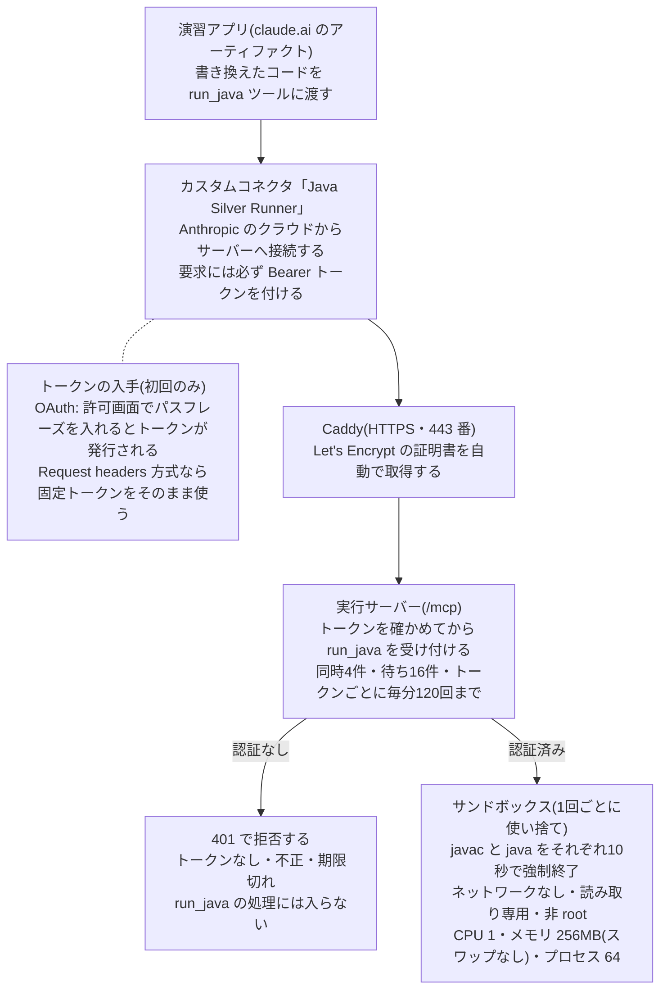

# Java Silver Runner デプロイとコネクタ登録の手順書

演習アプリで書き換えたコードを JDK 17 で実行するサーバー(`runner/`)を、自分のサーバーに立てて claude.ai のカスタムコネクタ「Java Silver Runner」として登録する手順です。実行はすべてこのサーバーの中で完結し、外部の実行サービスは使いません。

## 概要

- **認証が必須**: `/mcp` への要求はすべて Bearer トークンが必要です。OAuth で発行したトークンか、`.env` の固定トークンのどちらかです。認証のない `run_java` 呼び出しは処理に入る前に 401 で拒否します。トークンかパスフレーズが未設定なら、サーバー自体が起動しません。
- **実行の制限**: 1回の実行ごとに使い捨てのコンテナを起動します。javac と java はそれぞれ10秒で強制終了し、ネットワークなし(`--network none`)、CPU 1、メモリ 256MB(スワップなし)、プロセス 64、読み取り専用、非 root で動きます。
- **公開するのは `run_java` だけ**: ファイルは10個・合計64KBまで、出力は64KBで打ち切ります。同時実行は4、待ち行列は16、トークンごとに1分120回までです。



トークンのない要求は実行サーバーの入口で 401 になり、サンドボックスは起動しません。

| パス | 内容 |
| --- | --- |
| `runner/sandbox/` | 実行用の使い捨てコンテナ(JDK 17・非 root) |
| `runner/server/` | リモート MCP サーバー(Node.js 22)と動作確認スクリプト |
| `runner/compose.yaml` | server と Caddy の起動設定 |
| `runner/Caddyfile` | HTTPS の終端(証明書は Let's Encrypt から自動取得) |
| `runner/.env.example` | 設定の雛形 |
| `runner/README.md` | 最短手順の控え |

## 準備するもの

インターネットから HTTPS で届く Linux サーバー1台と、そこに向けたドメイン1つが必要です。claude.ai のコネクタは手元の PC ではなく Anthropic のクラウドから接続するため、社内網や自宅 LAN の中のサーバーには届きません。

| 項目 | 要件 |
| --- | --- |
| サーバー | Linux(Ubuntu 24.04 など)に Docker Engine と Docker Compose プラグイン。メモリは同時実行4 × 256MB に本体分を足して 2GB 以上が目安 |
| ドメイン | サブドメイン1つ(例 `runner.example.com`)。**A レコード**をサーバーの IPv4 アドレスに向ける(コネクタの接続元は IPv4) |
| ポート | 80 と 443 をインターネットに開く。80 は証明書の取得、443 は claude.ai からの接続と許可画面に使う |
| claude.ai | カスタムコネクタを追加できるアカウント。Free プランは1つまで。Team / Enterprise ではオーナーが組織の設定で追加する |

**このサーバーは実行サーバー専用にしてください。** サーバーのコンテナはホストの `docker.sock` を使ってサンドボックスを起動します。`docker.sock` を操作できるものはホストの root と同じ権限を持つため、ほかのサービスやデータを同じ VM に置かないでください。

Docker が未導入なら Docker 公式の手順で入れ、`docker compose version` が表示されることを確かめてから次へ進んでください。

## デプロイ手順

サンドボックスイメージを先に作り、`.env` を書いてから compose で起動します。コマンドはすべてサーバー上で実行します。

### 1. 一式をサーバーに置く

```bash
git clone <このリポジトリの URL> java-silver
cd java-silver/runner
```

### 2. サンドボックスイメージを作る

実行用イメージのベースは Eclipse Temurin の JDK 17(`eclipse-temurin:17-jdk-noble`)です。名前 `java-silver-sandbox:17` は `compose.yaml` と合わせてあるので変えないでください。

```bash
docker build -t java-silver-sandbox:17 ./sandbox
docker run --rm --entrypoint java java-silver-sandbox:17 -version
```

2行目で `openjdk version "17.0.…"` と出れば完成です。Dockerfile は BuildKit を使うので、Docker Engine 23 以降(BuildKit が既定)で作ってください。

ベースを特定の版に固定したいときは、取得したイメージのダイジェストを渡します。

```bash
docker pull eclipse-temurin:17-jdk-noble
BASE=$(docker inspect --format '{{index .RepoDigests 0}}' eclipse-temurin:17-jdk-noble)
docker build --build-arg BASE_IMAGE="$BASE" -t java-silver-sandbox:17 ./sandbox
```

### 3. `.env` を作る

ドメインだけ自分のものに置き換え、残りはそのまま実行します。パスフレーズとトークンはその場でランダムに作られます。

```bash
cp .env.example .env
sed -i "s|^RUNNER_DOMAIN=.*|RUNNER_DOMAIN=runner.example.com|" .env
sed -i "s|^RUNNER_OWNER_PASSPHRASE=.*|RUNNER_OWNER_PASSPHRASE=$(openssl rand -base64 18)|" .env
sed -i "s|^RUNNER_TOKENS=.*|RUNNER_TOKENS=$(openssl rand -hex 32)|" .env
sed -i "s|^DOCKER_GID=.*|DOCKER_GID=$(stat -c %g /var/run/docker.sock)|" .env
chmod 600 .env
cat .env
```

| 変数 | 使い道 | 制約 |
| --- | --- | --- |
| `RUNNER_DOMAIN` | 公開 URL(`https://<ドメイン>/mcp`)と証明書 | A レコードがこのサーバーを指していること |
| `RUNNER_OWNER_PASSPHRASE` | OAuth の許可画面で入力する合言葉 | 16文字以上 |
| `RUNNER_TOKENS` | 固定トークン(動作確認と Request headers 方式) | 各32文字以上、カンマ区切りで複数可 |
| `DOCKER_GID` | `docker.sock` のグループ ID | ホストの値と一致させる |
| `RUNNER_OAUTH_REDIRECT_PREFIXES` | OAuth で許可する戻り先 URL | 既定 `https://claude.ai/,https://claude.com/`。通常は変更不要 |
| `RUNNER_CONCURRENCY` / `RUNNER_QUEUE` / `RUNNER_RATE_PER_MIN` | 同時実行数 / 待ち行列 / トークンごとの1分あたり上限 | 既定 4 / 16 / 120 |

パスフレーズはコネクタ登録のときに使うので、パスワードマネージャーに控えておいてください。`.env` は他人に渡さず、Git にも入れないでください(`.gitignore` で除外済み)。

### 4. 起動する

```bash
docker compose up -d --build
docker compose ps
```

`server` が `healthy`、`caddy` が `running` になれば起動完了です。初回は Caddy が Let's Encrypt から証明書を取るまで少しかかります(`docker compose logs caddy` で `certificate obtained successfully` を確認)。`server` が再起動を繰り返すときは `docker compose logs server` に理由が出ます(末尾のトラブルシューティングを参照)。

## 動作確認

コネクタを登録する前に、4つの確認がすべて通ることを確かめます。`runner.example.com` は自分のドメインに置き換えてください。

**1. 外から HTTPS で届く**(手元の PC で実行)

```bash
curl -s https://runner.example.com/healthz
# → {"ok":true}
```

**2. 認証なしは拒否される**(手元の PC で実行)

```bash
curl -s -o /dev/null -w '%{http_code}\n' -X POST https://runner.example.com/mcp \
  -H 'Content-Type: application/json' -d '{}'
# → 401
```

**3. 実行と制限の確認**(サーバーの `runner/` で実行)

```bash
docker compose exec -e RUNNER_URL=http://localhost:8080/mcp \
  -e RUNNER_TOKEN="$(grep ^RUNNER_TOKENS= .env | cut -d= -f2 | cut -d, -f1)" \
  server node test/smoke.mjs
```

トークンなし・誤ったトークン・Bearer 以外が 401 になること、JDK 17 での実行、日本語のコンパイルエラー、パッケージと引数、例外、ネットワーク遮断、不正なファイル名の拒否を確かめ、最後に「すべて OK」と出ます。`-e SMOKE_SLOW=1` を足すと、無限ループが10秒で止まることも確かめます。

**4. OAuth の流れの確認**(サーバーで実行)

```bash
docker compose exec -e RUNNER_BASE=http://localhost:8080 \
  -e RUNNER_PASSPHRASE="$(grep ^RUNNER_OWNER_PASSPHRASE= .env | cut -d= -f2-)" \
  server node test/oauth-flow.mjs
```

クライアント登録、claude.ai 以外へのリダイレクトの拒否、許可画面、違うパスフレーズの拒否、PKCE、トークンでの `run_java`、リフレッシュを確かめます。テスト用のクライアントが1つ登録されますが、そのトークンはテストの中でしか使われません。

## コネクタ登録

claude.ai の「カスタマイズ → コネクタ」で、名前 `Java Silver Runner`・URL `https://<ドメイン>/mcp` のカスタムコネクタを追加し、OAuth で接続します。**名前は大文字・空白までそのまま入れてください。** アプリはこの名前でコネクタを探します。

### 個人プラン(Free / Pro / Max)の場合(推奨: OAuth)

1. [カスタマイズ → コネクタ](https://claude.ai/customize/connectors) を開き、「+」から「Add custom connector」を選ぶ
2. 名前に `Java Silver Runner`、URL に `https://runner.example.com/mcp` を入れる
3. 認証を設定する。ダイアログの形は組織によって違います
    - 1画面の形(名前・URL・Advanced settings): OAuth Client ID と Secret は**空欄のまま**にする
    - 2段階の形: Authentication は「Sign in now」、OAuth client は「**Register automatically**」を選ぶ。「Use Claude's published identity」はこのサーバーが対応していないので選ばない
4. 「Add」を押し、続けて「Connect」を押す
5. 開いた「Java Silver Runner の利用を許可」画面で、`.env` の `RUNNER_OWNER_PASSPHRASE` を入れて「許可する」を押す。claude.ai に戻り、接続済みになれば完了

パスフレーズを知っている人だけが接続できます。5回間違えるとその接続は無効になるので、claude.ai で「Connect」からやり直してください。発行されるアクセストークンは1時間で切れ、claude.ai がリフレッシュトークン(30日)で自動更新します。

### Team / Enterprise の場合

オーナーが [組織の設定 → コネクタ](https://claude.ai/admin-settings/connectors) で「Add」→「Custom」(種類を聞かれたら「Web」)を選び、同じ名前と URL で追加します。その後、各自の「カスタマイズ → コネクタ」で Custom ラベルの付いた Java Silver Runner の「Connect」を押し、上の手順5と同じく許可します。他のメンバーにも使わせるなら、パスフレーズを共有した人全員が実行できるようになる点に注意してください。

### 固定トークンで登録する場合(Request headers)

ダイアログに「Request headers」が出る組織だけが使える方式です(claude.ai 側でベータ提供中)。許可画面を通らず、固定トークンで接続します。

1. Authentication は「No sign-in」を選ぶ(サーバー側は引き続きトークン必須です)
2. Request headers で `authorization` を選び、値に `Bearer <RUNNER_TOKENS のトークン>` を入れる。`Bearer` と半角スペースも含める
3. Required にして「Add」を押す

どちらの方式でも、**認証の設定は追加後に変えられません。** 変えるときはコネクタを削除して追加し直します。名前と URL はあとから編集できます。

## アプリでの確認

演習アプリのプレイグラウンドで、ツールバーの表示が「書き換えも実行できます」になれば接続できています。

1. アプリを開き(開いていた場合は読み込み直し)、コード付きの問題を開く
2. コードの数値を1つ書き換えて「実行」を押す
3. コネクタの利用を確認する表示が出たら許可する
4. コンソールに「実行サーバー(OpenJDK 17.0.…)での実行結果」と出れば完了

書き換えていないコードは、これまでどおり事前に JDK 17 で検証した結果を表示し、サーバーは使いません。表示が「書き換えは実行できません」のままなら、末尾のトラブルシューティングを見てください。

## 運用

設定を変えたら `docker compose up -d` で反映します(変更のあったコンテナだけ作り直されます)。コマンドは `runner/` の中で実行します。

| 作業 | 手順 |
| --- | --- |
| ログを見る | `docker compose logs -f server`。1要求1行の JSON でパス・状態・時間だけを記録し、トークンやコードは残しません |
| 固定トークンの入れ替え | `RUNNER_TOKENS=<新>,<旧>` にして `up -d` → Request headers 方式ならコネクタを削除して新トークンで追加し直す → `<旧>` を消してもう一度 `up -d` |
| パスフレーズの変更 | `.env` を書き換えて `up -d`。発行済みの OAuth トークンはそのまま使えます |
| OAuth の接続をすべて取り消す | `docker compose down` → `docker volume rm runner_runner_data` → `docker compose up -d` → claude.ai でコネクタを削除して追加し直す |
| JDK とベースイメージの更新 | `docker build --pull -t java-silver-sandbox:17 ./sandbox` と `docker compose build --pull && docker compose up -d`。更新後は動作確認の3を流す |
| 混み具合の調整 | `.env` の `RUNNER_CONCURRENCY` などを変えて `up -d`。メモリは同時実行1つにつき 256MB を見込む |
| 止める | `docker compose down`(データは残る)。すべて消すなら `docker compose down -v` |

ボリューム名の前半は compose のプロジェクト名(既定ではディレクトリ名 `runner`)です。`docker volume ls` で確かめてください。

実行の制限(10秒・ネットワークなし・CPU・メモリ)は `runner/server/src/executor.mjs` と `runner/sandbox/run.sh` に固定してあり、`.env` からは変えられません。

### ファイアウォール

外に開くのは 80 と 443 だけです。サーバー本体の 8080 は compose の内部網にしか出していません。

```bash
sudo ufw allow from <自分のIP> to any port 22 proto tcp
sudo ufw allow 80/tcp
sudo ufw allow 443/tcp
sudo ufw enable
```

443 を Anthropic の送信元(`160.79.104.0/21`)だけに絞ると、許可画面を開く自分のブラウザーも届かなくなります。この構成では絞らず、認証で守ります。

## トラブルシューティング

まず `docker compose logs server` と、手元からの `curl https://<ドメイン>/healthz` を見ると、多くは原因が分かります。

| 症状 | 原因 | 対処 |
| --- | --- | --- |
| アプリに「コネクタ「Java Silver Runner」が見つかりません」 | コネクタが未追加か、名前が違う | 「カスタマイズ → コネクタ」で名前を `Java Silver Runner` に直す(名前は編集できる) |
| アプリに「接続が切れています」 | OAuth の期限切れ、またはサーバーのデータを消した | 「Connect」から接続し直す。だめならコネクタを削除して追加し直す |
| アプリに「実行サーバーに接続できませんでした」 | サーバー停止、DNS、証明書 | 手元から `/healthz`、サーバーで `docker compose ps` を確かめる |
| コネクタの追加や Connect がすぐ失敗する | Anthropic のクラウドからサーバーに届かない | A レコード(IPv6 だけのホストは不可)、80/443 の開放、証明書を確かめる。URL 末尾が `/mcp` かも確認 |
| Connect 後、許可画面が出ずに失敗。ログに `client registration rejected` | claude.ai の戻り先 URL が許可リストにない | ログの `redirect_uris` を見て、`.env` の `RUNNER_OAUTH_REDIRECT_PREFIXES` に追加して `up -d` |
| 許可画面で「有効期限が切れました」「パスフレーズが5回違いました」 | 許可画面は10分で切れ、5回間違えると無効になる | claude.ai で「Connect」からやり直す |
| Request headers 方式で接続できない(401) | 値に `Bearer ` がない、または消したトークン | 認証設定は変えられないので、コネクタを削除して追加し直す |
| `server` が再起動を繰り返す | 起動時チェックで止まっている | ログの文言どおりに直す。「RUNNER_TOKENS が設定されていません」など → `.env`、「サンドボックスイメージ … が見つかりません」→ 手順2 |
| ログに `docker.sock` の `permission denied` | `DOCKER_GID` がホストと違う | `stat -c %g /var/run/docker.sock` の値を `.env` に入れて `up -d` |
| 「実行サーバーが混み合っています」 | 待ち行列(既定16)が満杯 | 少し待つか、`RUNNER_CONCURRENCY` / `RUNNER_QUEUE` を増やす |
| Caddy が証明書を取れない | 80 番が外から届かない、DNS が未反映 | `docker compose logs caddy` を見て、DNS と 80 番を直して `docker compose restart caddy` |

## 参考

- [Add a connector that isn't in the directory](https://claude.com/docs/connectors/custom/add-unlisted)(追加手順、認証の選び方、Request headers、認証設定は変更不可)
- [Get started with custom connectors using remote MCP](https://support.claude.com/en/articles/11175166-get-started-with-custom-connectors-using-remote-mcp)(対象プラン、Free は1つまで、Anthropic のクラウドから接続)
- [IP addresses](https://platform.claude.com/docs/en/api/ip-addresses)(Anthropic の送信元 `160.79.104.0/21`)
